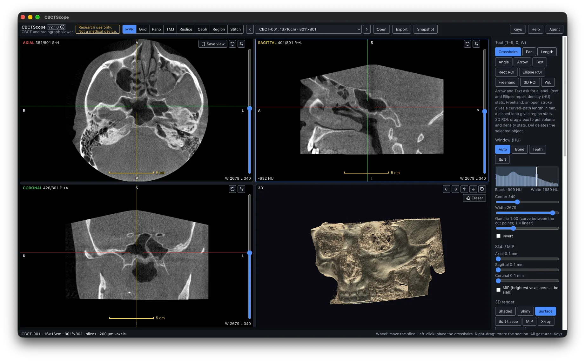
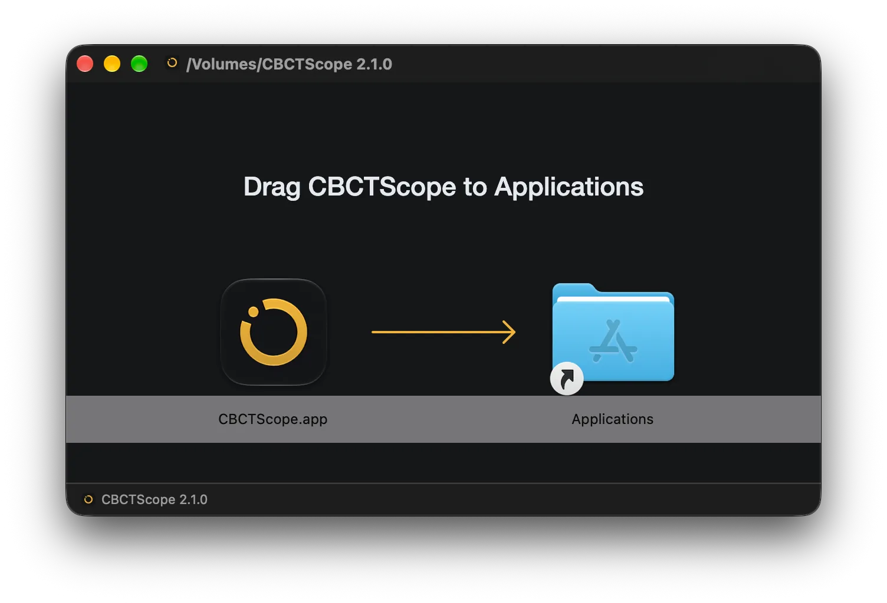

# 2 · Installation and startup

## Which one do I have?

- **The website** ([cbctscope.com](https://cbctscope.com)): nothing is
  installed. The viewer runs in your browser tab; section 2.5 describes it.
- **The desktop app** (**CBCTScope** in Applications on macOS, or installed
  from the Windows setup file): section 2.6.
- **The repository** (the project's code, started with a double-click starter
  or `npm run dev`): sections 2.1 to 2.4 below. Only this form needs Node.js.

## 2.1 System requirements

- **Node.js 22 or later**: the free runtime that runs the viewer. Download the
  LTS installer from [nodejs.org](https://nodejs.org) and run it with the
  default options.
- **A current desktop browser** with WebGL2 (Chrome, Edge, Firefox, or
  Safari). The 3D render and all reformats are computed on this machine, so a
  recent computer with a working graphics driver is assumed; large volumes
  read more comfortably with more memory.
- **A screen at least 1024 px wide.** The header holds every control on one
  row from about 1410 px and wraps onto a second row below that. Below 768 px
  (a phone) cbctscope.com shows a short page instead of the viewer: what
  CBCTScope is, a picture of it, the line that it reads scans on a computer,
  and buttons for the user manual, the desktop app downloads, and "Send this
  link to myself", which opens your phone's mail app with the address filled
  in. A desktop window narrowed below 768 px shows the same page, and the
  viewer returns when it is widened again; a scan you had open is opened
  again from the Open menu.
- **macOS, Windows, or Linux.** The file-open dialog is native on macOS and
  Windows; on Linux it uses the desktop's dialog helper (zenity or kdialog,
  one of which most distributions ship). Section 4.4 gives a one-line
  fallback command for a Linux desktop with neither.

## 2.2 Installing

1. Get the code: on the GitHub project page, click the green **Code** button,
   choose **Download ZIP**, and unzip it somewhere permanent. With git,
   `git clone` works as usual.
2. On macOS and Windows, that is the whole installation: the starter file in
   section 2.3 downloads the viewer's components by itself on first run
   (once; section 2.3 gives the size). To install from a terminal instead,
   open one in the
   unzipped `cbctscope` folder and run `npm install`.
   On macOS: open Terminal, type `cd ` with a trailing space, drag the folder
   onto the Terminal window, press return.
   On Windows: open the folder in Explorer, click the address bar, type
   `cmd`, press enter.

Updating to a newer release is the same procedure with the newer code, and
`npm install` again. Uninstalling is deleting the folder; section 10.2
describes the one small app-data folder that the viewer writes elsewhere.

## 2.3 Starting and stopping

**By double-click** (macOS and Windows): in the `cbctscope` folder,
double-click **Start CBCTScope.command** (macOS) or **Start CBCTScope.bat**
(Windows). It installs on first run if needed, starts the viewer in normal
mode, and opens the browser by itself once the viewer answers. If macOS or
Windows shows a security prompt on this first open, chapter 11 gives the
one-time answer for each system. The first run downloads the viewer's
components once: about 130 MB downloaded, 600 MB on disk, ten to fifteen
seconds on the author's Mac and connection in September 2026, longer on a
slow one.

**From a terminal** (any OS, and the way to choose demo mode): in the
`cbctscope` folder run

```sh
npm run dev
```

for normal mode, or `npm run demo` for demo mode (section 2.4). Then open
**http://localhost:3810** in your browser. The built-in phantom loads
immediately.

To stop the viewer, press `Ctrl-C` in its window or close the window. The
browser tab then shows a connection error, which is expected. Restarting takes
only the start step; `npm install` is not repeated.

> **Note.** The viewer serves exactly one reader on one machine. It refuses
> connections from other devices by design; it is not a PACS and cannot be
> made into one.

## 2.4 Demo mode and normal mode

`npm run demo` starts **demo mode**: the viewer never restores and never
remembers an opened scan, so a screen recording or a teaching session can
never accidentally surface a previous real case. Scans can still be opened
deliberately within the session.

`npm run dev` and the double-click starters run **normal mode**: identical
viewer, but the last opened source is remembered and restored on the next
start, which is the convenient behavior for daily reading.

Both commands behave the same on every OS.

On first launch both modes show the built-in phantom.

## 2.5 The web build

The viewer also runs in a browser with nothing installed: the **web build**,
deployed to cbctscope.com by every published release. It is static files only,
with no server behind it. It needs only a current desktop
browser with WebGL2; Chrome or Edge read folders most reliably (chapter 11).


What differs from the local app:

- Until the viewer has loaded, the page shows what CBCTScope is, who made it,
  that scans are read in the tab and never uploaded, and that it is research
  software, with links to this manual, the eight reading guides, the About
  and legal pages, the source code and the author's page. A browser without
  JavaScript keeps that page and says that the viewer needs JavaScript and
  the manual does not.
- Scans are opened with the browser's own picker or by a drop on the viewer
  (section 4.6), and read into the tab. Nothing is uploaded.
- Marks live in the browser's storage and travel as a marks file (section 7.3).
- A volume above the size threshold (512 MiB of voxels by default) shows a
  notice first, because the browser must hold it in memory. The repository
  viewer (section 2.3) holds the volume in a browser tab as well; it shows no
  notice.
- There is no MCP connection in a plain browser (chapter 9); the desktop app
  (section 2.6) adds it. The opt-in in-page navigation agent, on your own
  model account, works in both (section 9.6).
- The header reads **Research use only. Not a medical device.** at all times.
  Its last button, **Download the desktop app** (on a narrower window,
  **Desktop app**), opens a menu of direct downloads from the latest
  release: **Mac with Apple silicon**, **Mac with Intel** and **Windows**
  (the installer), then the line "Which Mac? Apple menu, About This Mac.
  Chip: Apple M1 or later is Apple silicon. Processor: Intel is Intel.",
  then **All downloads and release notes**, the release page
  (`/releases/latest` on the project's GitHub page). Your own system's entries come first (the Macs on
  macOS, Windows on Windows); every entry is always there. Clicking an entry
  starts the download in your browser; opening the menu contacts nothing.
  The menu moves with the arrow keys and closes with Escape, like the other
  menus (section 3.1). **Help** opens this manual,
  served by the site itself, in a new tab, and links the source code
  repository; in the desktop app it opens the manual drawer instead
  (section 3.1).

To build it yourself: `npm run build:web` writes the site to `out/`. Serve
that folder with any static file server. The threshold is set at build time
with `NEXT_PUBLIC_CBCTSCOPE_SIZE_NOTICE_MIB`; a site under a sub-path (such as
`/cbctscope`) needs `NEXT_PUBLIC_BASE_PATH`.

## 2.6 The desktop app

The **desktop app** is the web build in its own window, with the AI-agent
bridge built in: no Node.js, no terminal, no browser tab to keep open. It runs
the same browser engine the web build is tested on (Chromium, through
Electron), so every reading mode behaves the same.



**Download.** The website's **Download the desktop app** menu (section 2.5)
links each installer directly. Every release that carries the app lists its
files on the project's GitHub releases page, each installer twice: under its
versioned name below, and under a fixed name that is the same in every
release, which the menu's links use: `CBCTScope-mac-arm64.dmg`,
`CBCTScope-mac-x64.dmg` and `CBCTScope-windows-setup.exe`. The two names hold
the same file, byte for byte: the fixed name is a copy of the finished file,
made after the macOS signing, notarising and stapling steps (the Windows
installer has none), so either download is the same app.

- macOS: `CBCTScope-<version>-arm64.dmg` for Apple silicon,
  `CBCTScope-<version>-x64.dmg` for an Intel Mac (a `.zip` of each is there
  too). Open the dmg: a dark window titled **CBCTScope** and the
  version number shows the app and the **Applications** folder, their names
  on a grey band, with the line "Drag CBCTScope to Applications". Drag **CBCTScope** onto **Applications**, then
  eject the disk image. Both the app and the disk image itself are signed
  and notarised by Apple, with the ticket attached, so macOS checks them
  even offline and asks only its usual question for an app downloaded from
  the internet, on the first launch.

  The picture below was taken on a Mac whose Finder shows the folder path in
  the title bar and every file extension, so its window reads
  `/Volumes/CBCTScope 2.1.1` and `CBCTScope.app`; a Finder set otherwise
  shows the shorter names.

  
- Windows: `CBCTScope-<version>-setup.exe` installs for the current user;
  `CBCTScope-<version>-portable.exe` runs without installing. Both are
  unsigned, so on first launch Windows SmartScreen shows **Windows protected
  your PC**: choose **More info**, then **Run anyway** (once).

**First launch.** The window opens on the built-in phantom, as the web build
does, at 1440 by 900 pixels (smaller on a smaller screen); it never goes below
1024 by 700. **Open DICOMDIR or DICOM Folder…** in the File menu (`Cmd-O` on macOS, `Ctrl-O` on Windows) or the
**Open** menu in the header opens your own export through the system's folder dialog; the
dialog's button may read **Upload**, which is the browser engine's standard
wording: the files are read into the app and nothing is sent anywhere. Closing
the window quits the app. **CBCTScope Help** in the app's Help menu opens this manual beside
the viewer, and **View** holds Actual Size, Zoom In, Zoom Out and full screen; section 3.8
lists every menu.

**What the app remembers.** Between launches the app remembers the window's
size and position (and whether it was maximized) and the window preset you
last picked (Auto, Bone, Teeth or Soft, with a preset button or the agent's
window verb), in its own profile, and opens every CT volume on that preset;
a 2D radiograph always opens on Auto. Opening or switching a volume never
changes the remembered preset, nor does a hand-set window. The profile holds a small file
`window-state.json` holding those four numbers and the flag, and the preset's
name in the app's storage. It keeps no folder name, file name or anything
from a scan, and a window whose screen is gone opens centred again. The
reading place (slice and crosshair, section 3.3) is kept between modes, not
across a relaunch. The website remembers none of this.

What differs from the repository starters (section 2.3):

- Scans are read the web build's way (section 2.5): through the dialog or a
  drop, into the app's memory, with marks in the app's own storage and the
  marks file to carry them. The large-volume notice applies.
- The app opens no browser and asks for no install step; updating is
  downloading the newer release (below).
- AI-agent control works with the same setup as the repository (chapter 9):
  the app listens on `http://127.0.0.1:3810`, the address the MCP server and
  the one-click bundle use by default. The app always uses that port: the
  address is where its marks, the research-use acknowledgement and the agent
  settings are kept, so another port would silently lose them. If another
  program already holds port 3810 (often the repository's viewer), the app
  says "CBCTScope is already running, or another program uses its port",
  explains that the viewer started from a terminal is the likely cause, and
  quits (section 11).
- The app accepts connections from this computer only, exactly as the
  repository's viewer does.
- The agent verbs `open_scan` and `pick_scan` are not available in the app:
  it has no route that takes a file path. Open the scan with **Open DICOMDIR or DICOM folder**,
  then the agent reads the catalog with `list_volumes`.

**Removing the desktop app.** On macOS, quit CBCTScope and drag it from
**Applications** to the Trash; on Windows, uninstall it in **Settings** under
**Apps** (the portable build is simply deleted). Removing the app leaves its
profile behind: the app's own storage, holding your marks, the research-use
acknowledgement, the agent settings, the window's size and position and the
window preset, and the browser engine's caches (about 20 MB after a first
session). On macOS that is the folder
`~/Library/Application Support/cbctscope` and the preferences file
`~/Library/Preferences/com.cbctscope.app.plist`; on Windows, the folder
`%APPDATA%\cbctscope`. To remove them as well, with the app quit: in the
Finder, choose **Go to Folder** in the **Go** menu, enter
`~/Library/Application Support`, and move the **cbctscope** folder to the
Trash, then do the same for `com.cbctscope.app.plist` in
`~/Library/Preferences`. From Terminal, the same is

```sh
rm -rf ~/Library/"Application Support"/cbctscope
defaults delete com.cbctscope.app
```

On Windows, delete the folder you reach by typing `%APPDATA%\cbctscope` into
the Explorer address bar. Deleting the profile deletes the marks kept in it;
save them to a marks file first (section 7.3) to keep them. No scan is ever
stored there: scans stay where they were opened from.

**Updating the desktop app.** The app never checks for updates by itself and
contacts nothing. **Check for Updates…** (in the **CBCTScope** menu on macOS,
right after About; near the end of **Help** on Windows, before About) and
**Check for updates** in the version panel (section 3.1) open the website's
update page in your browser. The installed version travels after the `#`
sign of the address, for example `https://cbctscope.com/update#from=2.1.0`:
browsers keep that part of an address to themselves and do not send it to
any server. The page compares it with the newest version, which the site
knows because every release publishes the site again, and says which is
newer: "You have CBCTScope 2.1.0. The newest version is 2.2.0." with the
downloads and the release notes, or "You have the newest version of
CBCTScope, 2.1.0.". For a version newer than the page knows (a build of your
own, or a release the site has not caught up with) it says which version it
knows as the newest release. Opened without a version, it names the newest
version and offers the downloads.

To install the new version over the old one: on a Mac, quit CBCTScope, open
the new disk image and drag **CBCTScope** onto **Applications**, replacing
the old copy; on Windows, quit CBCTScope and run the new setup file, or, with
the portable build, replace the old portable file with the new one. Marks
and settings are kept in the app's profile (above), not inside the app, and
the installed and the portable build use the same profile folder, so the new
version finds them.

To build it yourself: `npm run desktop` starts it from the repository against
`out/` (building the web target first if `out/` is missing), and
`npm run desktop:build` packages it into `dist-desktop/`.
